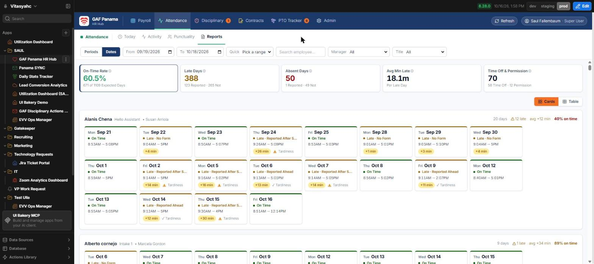
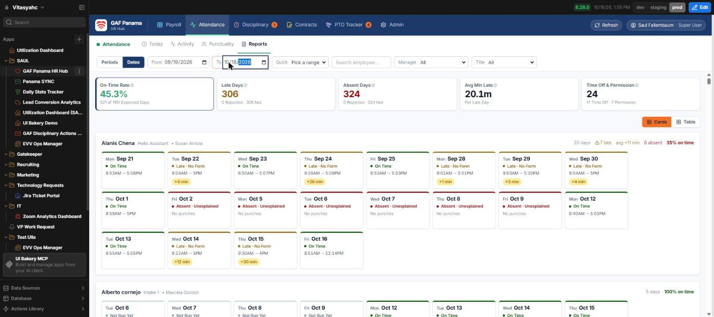

# Oct 2–10 "absences" on Attendance → Reports: the punches are there, the page showed a stale answer

**2026-10-19. Read-only investigation. No data changed, no UIB prompt sent.**

## Answer for Saul, in one paragraph

These are **not real absences and no data is missing.** Every payroll row for Oct 2–10 is in
the database with its clock-in and clock-out times. Reports showed them as absent because of a
**screen glitch in the date boxes**: typing a date into From/To sends a new query on *every
keystroke*. Halfway through typing "10/18/2026" the box briefly holds **10/01/2026**, and the
app asks the database for "Sep 19 to Oct 1". When that half-typed answer arrives *last*, the
page draws Sep 19 – Oct 18 with payroll rows only up to Oct 1. Oct 2–10 fall inside the
processed period Q1-Oct but have no row on screen, so every one of them is drawn as
"Absent · Unexplained, No punches". Oct 11 onward still looks right because those days come
from Teramind, not payroll. **Nothing needs fixing in payroll.** The page needs a small fix so a
half-typed date can never win (see "What it would take to fix" below).

## Evidence

### 1. The stored data is complete (read from the page's own loader, prod and dev agree)

`loadAttendanceReportDays` for Sep 19 – Oct 19 returned 640 rows. Per day:

| Date | Payroll rows | Rows with a clock-in | Period |
|---|---|---|---|
| Mon Sep 28 | 41 | 39 | Q1-Oct-2026 |
| Thu Oct 1 | 41 | 36 | Q1-Oct-2026 |
| **Fri Oct 2** | 41 | **38** | Q1-Oct-2026 |
| Sat Oct 3 | 4 | 4 | Q1-Oct-2026 |
| Sun Oct 4 | 3 | 3 | Q1-Oct-2026 |
| **Mon Oct 5** | 41 | **37** | Q1-Oct-2026 |
| **Tue Oct 6** | 41 | **39** | Q1-Oct-2026 |
| **Wed Oct 7** | 42 | **39** | Q1-Oct-2026 |
| **Thu Oct 8** | 42 | **38** | Q1-Oct-2026 |
| **Fri Oct 9** | 42 | **39** | Q1-Oct-2026 |
| Sat Oct 10 | 3 | 0 | Q1-Oct-2026 |

Oct 2–9 look just like Sep 28. Payroll rows end on Oct 10, the last day of Q1-Oct. The Teramind
pull log also covers the stretch (`2026-09-25 → 2026-10-10` captured Oct 9–10, plus a manual
`2026-10-01 → 2026-10-16` pull on Oct 16). The three Oct 10 rows have no clock-in, and on screen
they show as Permission, not Absent.

### 2. When the range loads cleanly, Reports agrees with the data

Prod, Dates mode, Sep 19 – Oct 18, with both dates set in one step:
**50 absent days out of 1,109 expected**. Mon Oct 5 reads **37 On Time, 15 Late, 4 PTO,
1 Absent** (the earlier report said 32 Unexplained + 8 Reported).

Counted from the page for the other days: Oct 2: 33 on time / 19 late / 2 absent.
Oct 6: 30 / 25 / 0. Oct 9: 34 / 20 / 1. Sep 28: 32 / 20 / 3.

### 3. Reproduced: type the To date, get the bug

Same page, same From date. I clicked the To box and typed `10182026`. The box ends up reading
10/18/2026, yet the page now shows **324 absent days**, and every Oct 2–9 card reads
"Absent · Unexplained, No punches":

What the network log showed while typing (35 queries for one date edit):

- Queries went out for `To = 2026-10-18`, then `2026-10-01` (the half-typed value), then
  `0002-10-18`, `0020-10-18` and `0202-10-18` (the year typed digit by digit), plus reversed
  From/To pairs.
- The burst exhausted the database connections. 12 of the 35 came back `too many connections`,
  **including the real `Sep 19 → Oct 18` payroll query.**
- The half-typed `Sep 19 → Oct 1` payroll query came back *after* that and returned **381
  rows**, exactly the number of payroll rows from Sep 19 to Oct 1 (3+3+41+41+41+42+41+3+3+41+40+41+41).
  That stale answer is what the page drew.
- The red "Error loading report data" banner did **not** appear, because the stale answer
  arrived after the error. The forms load was hit the same way: the tile read
  "0 Reported · 324 Not".
- Pressing the app's **Refresh** button did not recover it (it sat on "Refreshing…"). A full
  browser reload did, but the reload also resets the filter to the current period.

That also explains every detail of the original report: absent from Fri Oct 2 (the day after
the half-typed Oct 1) through Oct 10 (the end of the processed period), the weekend workers
absent on Oct 3/4/10 too, Sep 28 normal, and Oct 12 onward normal (those days come from Teramind).

## What it would take to fix (needs Saul's OK, no prompt sent)

Payroll: **nothing.** No re-run and no import needed.

The page: one small change in the date boxes. They live in
`src/app/components/AttendanceRangeControls.tsx` (lines 133 and 137, used by Today, Activity,
Punctuality and Reports) and `src/app/FilterBar.tsx` (lines 209 and 211). Each keystroke calls
`setDateFrom`/`setDateTo` directly. Options, from smallest:

1. **Only apply a date once it is a complete, sensible date.** Ignore anything that is not
   `YYYY-MM-DD` with a year between 2020 and 2100. This alone removes the 0002/0020/0202 queries.
2. **Apply on blur or Enter, or after the typing pauses (~500 ms), instead of on every
   keystroke.** This removes the half-typed `10/01` query. It is the real fix.
3. (Belt and braces) Show the error banner if *any* report loader errored in the last round,
   so a stale draw can never look complete.

1 + 2 together would be one prompt touching only those two files. A test can pin it: a pure
helper (e.g. `isCompleteYmd`) with cases `0002-10-18 → false` and `2026-10-01 → true`. Debouncing
itself can only be checked in the browser.

**Workaround until then:** pick the range from the **Quick** menu, or use the calendar picker
instead of typing. If the numbers look wrong after typing a date, reload the browser tab.

## Side effect for the low on-time-rate meeting list

The Oct 2–10 days that were left out as a "data gap" are real, normal days and can be put back.
Rebuild the list from a clean load: set the range with the calendar picker or Quick menu, then
check that the Absent Days tile reads about 50 for Sep 19 – Oct 18, not about 300.
